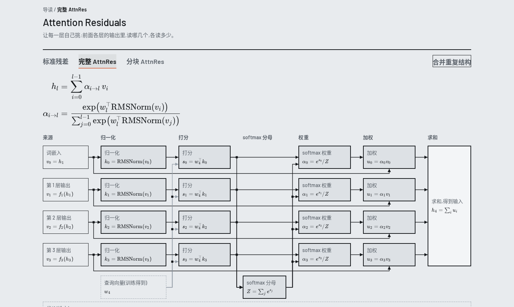
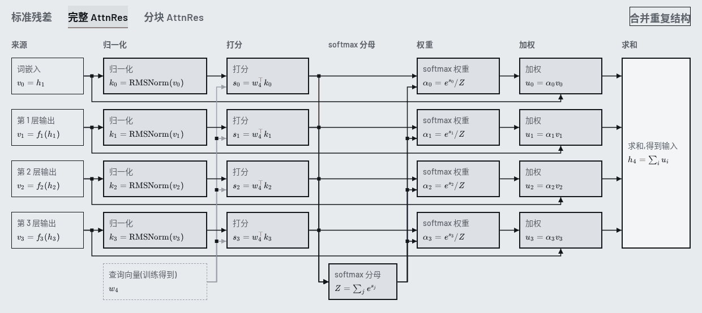
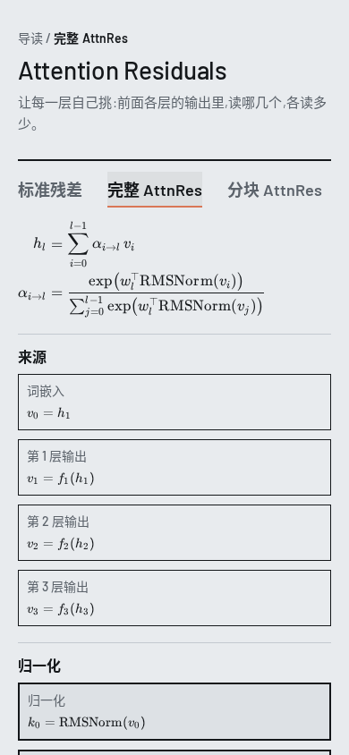

# braun-schematic-web

一个 Agent Skill,用于把论文、模型结构、算法和形式化系统做成单文件讲解页。页面由三部分组成:算符级计算图(框里写算式,线是真实数据流)、LADR 风格讲义、点击展开的术语。视觉统一为 Braun 说明书风格,所有页面不引用外部资源,任何设备上没有横向滚动条。



图 1:用本 skill 做的 Attention Residuals(Kimi Team,arXiv 2603.15031)导读页中的计算图。每个来源依次经过归一化、打分、softmax、加权,最后求和。

## 1. 目标与约束

讲论文时常见的两个问题是:图只画"谁连谁",读者看不出计算关系;补充说明散在图下和框旁,读者要么不读,要么读了仍然不懂。本 skill 要同时解决这两件事,约束如下:

1. 图里每个框写算式,不只写名字。每个运算一个框,线是量真的流过去,不画程序不读的输入。
2. 少加补充说明。图例、记号、术语只在讲义里定义一次,需要展开的做成点击展开。
3. 论文自己的论断、他人复现、作者的评价分开标注,读者能看出哪些是证据、哪些是推断。
4. 页面是单文件,字体和公式在构建时嵌入,断网也是同一个外观。
5. 视觉统一:冷白灰、细线、无卡片、全程直角(含 SVG),陶土色是唯一点缀。
6. 动效只响应点击,不自动播放,尊重系统的减少动效设置。

## 2. 页面组成

### 2.1 计算图

图按"阶段(列)× 车道(行)"排版,线由脚本按框的实际位置自动布成直角线。黑色方块表示分叉,线交叉不表示连接。点任意一个框,相连的线变成陶土色,其余淡出,上方读数栏显示它的算式和说明。

三个标签页对应三种做法。完整版和分块版共用同一套 7 列,同一种运算总停在同一列,切换时只需要看哪里变了。


图 2:分块版把 4 个来源减成 3 个,归一化之后的运算和完整版相同。

### 2.2 合并重复结构

四个来源各做一遍的归一化、打分、softmax、加权,结构完全相同。页首的"合并重复结构"按钮让后三条车道向第一条汇合并淡出(约 0.5 秒,缓入缓出,不回弹),框里的算式换成带下标 i 的通式,求和变成 `Σ_{i=0}^{3}`。再点一下展开。



图 3:合并重复结构的动画。只响应点击;系统设了减少动效则直接切换。

### 2.3 讲义

讲义是 LADR 风格:先定义,再陈述,最后给注,每条短而完整,记号在第一次用之前讲清。每条标出处。条目类型分为记号、定义、注、论断、他人结果。点一条,图上只留下它说到的框;点图上的框,读数栏显示对应算式。


图 4:选中打分框 `s_2`。相连的线变成陶土色,读数栏显示 `s_2 = w_4ᵀ k_2`,下方是讲义。

### 2.4 窄屏

宽度不超过 1000px 时图隐藏,改成按阶段分组的清单,每项仍带算式,点击行为不变。原因是图缩小后文字会低于可读下限。



图 5:390 宽下的清单视图。

## 3. 数据与证据语义

- 页面的图由一个 JSON 数据块描述:模式、阶段、节点、连线。数据格式见 `skills/braun-schematic-web/references/compute-graphs.md`。
- 讲义条目的类型区分证据强度:定义和记号是约定;论断是论文自己的结论,页面没有验证;他人结果是第三方复现;评价是作者判断,单独标注。
- 页面没读到的部分写在页脚。示例页只读到论文摘要至 §5.4 开头,§6 和附录没读。
- 引用二手材料要写明哪一条来自二手。

## 4. 视觉规范

- 冷白灰底 `#E8EBEE`,冷黑墨 `#14171A`;没有暖色、渐变、阴影、噪点。分区靠留白和一条 1px 细线,不用卡片。
- 字体为 Barlow 加思源黑体,数字用 `tabular-nums`,公式用 KaTeX。
- 一个圆角都没有,包括 SVG 的 `rx` 和线帽。
- 点缀色只有 Claude 陶土 `#D97757`,用作"文字下方一条线"和选中态,面积小于 1%。
- 可见文字 HTML 不小于 14px,SVG 实际渲染不小于 12px。
- 360 到 2560 宽度下没有页面级横向滚动条。


图 6:视觉层的另一个示例,梯度下降学习页,不含计算图。

## 5. 安装与使用

**Claude:** 下载 Releases 里的 `braun-schematic-web.skill`,或把 `skills/braun-schematic-web/` 打成 zip 上传到 Skills。

**Codex 等:** 把 `skills/braun-schematic-web/` 放到 `<仓库>/.agents/skills/` 下。不支持 SKILL.md 目录的 agent,把 `AGENTS.snippet.md` 并入 `AGENTS.md`。

**构建一个页面:**

```
python skills/braun-schematic-web/scripts/build_page.py src.html out.html
python skills/braun-schematic-web/scripts/check_schematic.py out.html
python skills/braun-schematic-web/scripts/check_viewports.py out.html
```

`build_page.py` 内联 CSS 和 JS,把字体子集化后以 base64 嵌入,在构建时用 KaTeX 预渲染公式,并报告缺字。完整例子见 `examples/attention-residuals/src/make.py`。

依赖:

- Python 3、fonttools、brotli、Playwright 与 Chromium;
- node,以及 `npm i katex @fontsource/barlow @fontsource/barlow-semi-condensed @fontsource/ibm-plex-mono`;
- 含简体中文的 Noto Sans CJK(`.ttc`)。

路径用环境变量 `NODE_MODULES`、`CJK_TTC` 指定。

## 6. 验证状态

在示例页 `examples/attention-residuals/attention-residuals.html` 上运行:

| 项目 | 结果 |
|---|---|
| `check_viewports.py`(360、390、768、1024、1440、1920、2560 七个宽度:溢出、圆角、小字、公式渲染) | 7/7 通过 |
| `check_viewports.py` 跑学习页示例 `example.html` | 7/7 通过 |
| `check_schematic.py`(三个模式:线不穿框、箭头贴框、框内文字不溢出、读数栏非空) | 3/3 通过 |
| `check_schematic.py`(讲义 `data-n` 的 id 全部存在;390 与 768 宽窄屏清单生效且无溢出;无脚本错误) | 通过 |
| 构建缺字检查 | 无缺字 |
| 页面中的外部 URL | 0 个 |
| 数字核对(下游成绩表 15 项的差值、消融表差值) | 脚本相减,与手算一致 |

## 7. 已知限制

1. 计算图的线是自动布的,只有三种走法(`hv`、`vh`、`drop`)。复杂回环要拆成两个框。
2. 折叠只支持一段连续的车道。折叠动画只在完整 AttnRes 模式测过。
3. 没有真实读者验证过计算图的可读性。冷读只验证过上一版的文字部分。详见 `examples/attention-residuals/REVIEW.md`。
4. 窄屏的清单没有连线,"谁接谁"只能靠每项里的文字。
5. 三个模式靠标签页切换对比,没有并排。标准残差只有 3 列,和另外两个模式的列对不上。
6. 示例页只读到论文摘要至 §5.4 开头,§6 和附录没读;公式和表格取自 ar5iv 全文以及官方仓库、alphaXiv 概述,没有对照 PDF。
7. 构建依赖 Noto Sans CJK 的 `.ttc` 路径,默认是 Linux 下的 `/usr/share/fonts/opentype/noto/`,其他系统要设 `CJK_TTC`。

## 8. 仓库结构

```
skills/braun-schematic-web/        skill 本体
├── SKILL.md                        规则、工作流、反小字准则、禁止清单
├── references/                     compute-graphs.md  theorem-schematic.md  learning-pages.md  ...
├── assets/                         tokens.css  base.css  schematic.css/.js  example.html ...
└── scripts/                        build_page.py  check_viewports.py  check_schematic.py ...
examples/attention-residuals/       导读页源码(src/make.py)、构建结果、自查记录(REVIEW.md)
docs/img/                           README 图示
braun-schematic-web.skill           打包好的 skill
LICENSE                             MIT
```

## License

MIT
