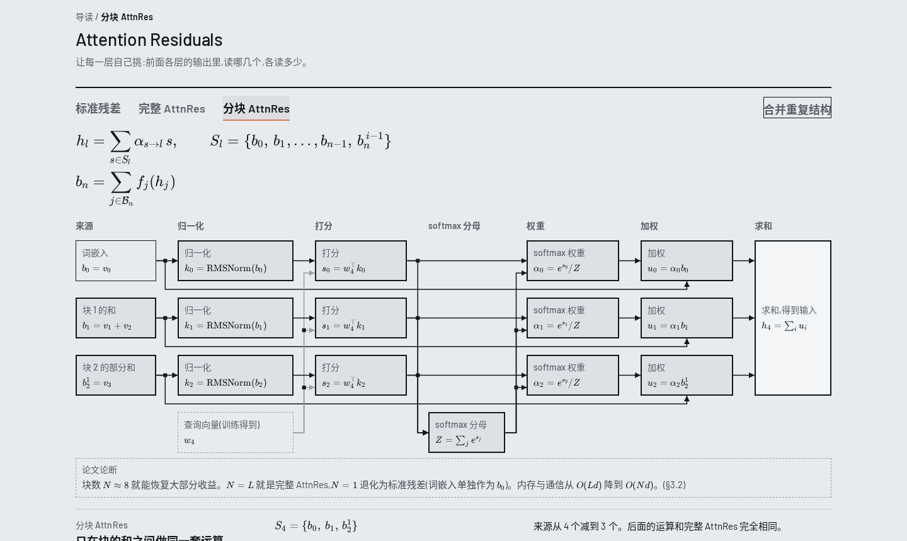
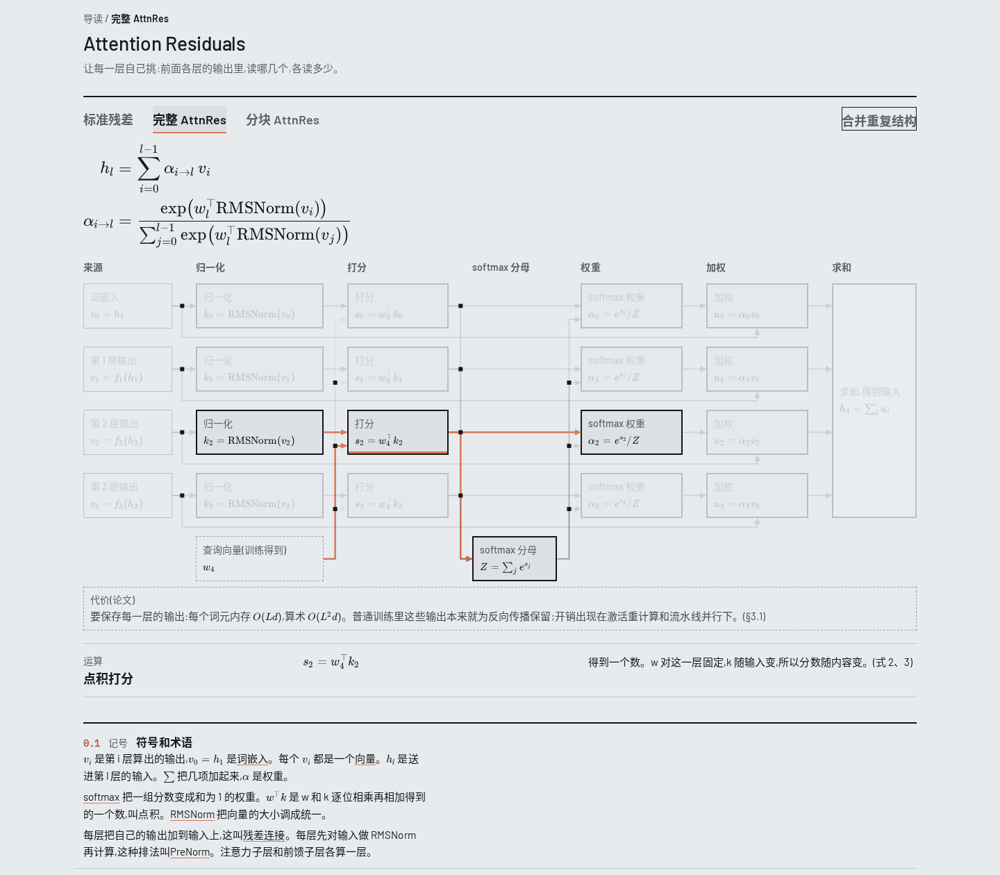
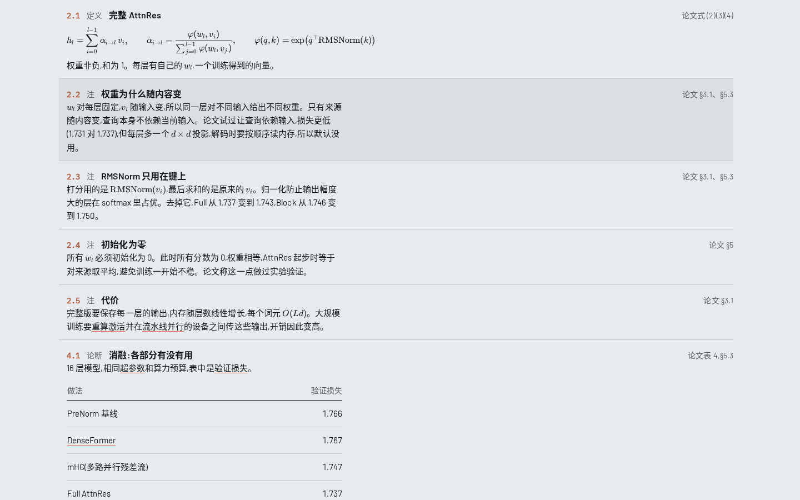
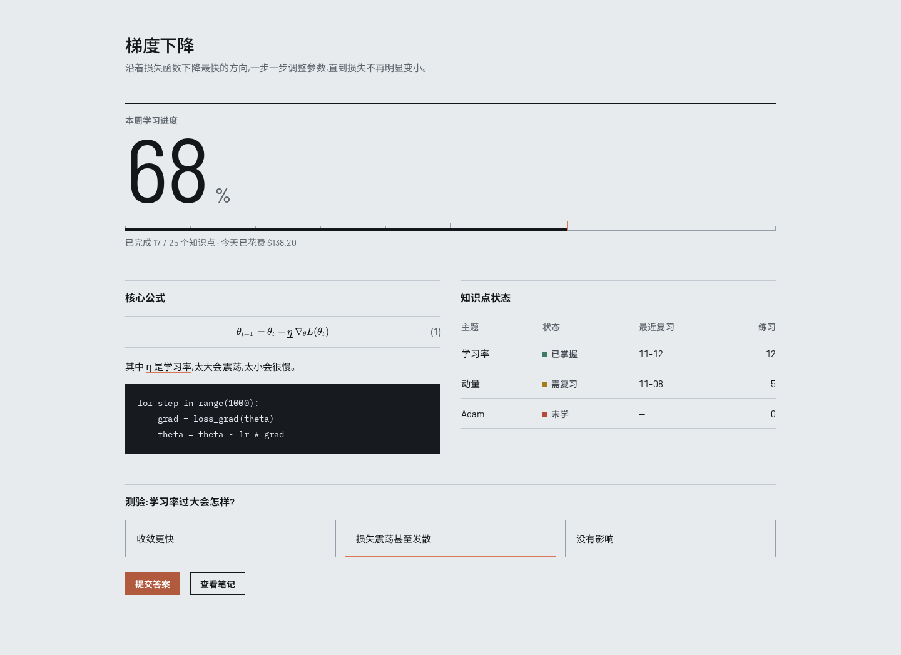

# braun-schematic-web


一个 Agent Skill,分两层:

- **视觉层。** Braun 说明书风格的 lo-fi 网页:冷白灰、细线、无卡片、全程直角(含 SVG)、Claude 陶土色作唯一点缀、任何设备上没有横向滚动条。
- **讲解层。** 把论文、模型结构、算法、形式化系统讲给零基础读者:算符级计算图(框里写算式,线是真实数据流)、LADR 风格讲义、点击展开的术语,以及子代理复核和机械检查流程。

## 展示

下面是用这个 skill 做的 Attention Residuals(Kimi Team,arXiv 2603.15031)导读页。源码在 `examples/attention-residuals/`。

### 算符级计算图

完整 AttnRes 求第 4 层输入的全过程:每个来源先归一化,和查询向量打分,经 softmax 得到权重,乘回没归一化的来源,最后求和。每个框里是算式,线是真实的数据流,黑色方块表示分叉,线交叉不表示连接。


三个标签页切换三种做法,车道和阶段的位置保持一致,差别一眼可见。分块版把 4 个来源减成 3 个,后面的运算完全相同:



### 合并重复结构

四个来源各做一遍的归一化、打分、softmax、加权,结构完全相同。点"合并重复结构",后三条车道向第一条汇合并淡出,框里的算式换成带下标 i 的通式,求和变成 `Σ_{i=0}^{3}`。再点一下展开。只响应点击,不自动播放;系统设了减少动效就直接切换。


### 点开一个框

选中打分框,相连的线变成陶土色,其余淡出,读数栏显示它的算式和说明。点讲义的一条,图上只留下这条说到的框。带下划线的术语点一下在原地展开。



### 讲义

LADR 风格:先定义,再陈述,最后给注,每条短而完整。论断、他人结果和定义用不同的标记区分,读者能看出哪些是证据、哪些是推断。



### 手机

窄屏不缩小图(缩小后文字会低于可读下限),改成按阶段分组的清单,每项仍带算式,点击行为不变。


### 视觉层:学习笔记页



## 特点

- **可折叠。** 重复的车道可以一键合并成通式,再点展开。
- **反小字准则。** 少加补充说明;该讲的用 LADR 风格在讲义里讲一次;图例和术语只定义一次,需要展开的做成点击展开。可见文字 HTML 不小于 14px,SVG 不小于 12px。
- **单文件,不引用任何外部资源。** `build_page.py` 内联 CSS 和 JS,字体子集化后嵌入,KaTeX 在构建时预渲染。断网、预览面板、任何电脑上都是同一个外观。
- **机械检查。** `check_viewports.py` 查 7 种宽度的溢出、圆角、小字、公式渲染。`check_schematic.py` 查连线穿框、箭头贴框、文字溢出、读数栏非空、窄屏清单。
- **证据分层。** 讲义每条标出处;论文自己的论断、他人复现、我的评价分开写。

## 安装

- **Claude:** 下载 Releases 里的 `braun-schematic-web.skill`,或把 `skills/braun-schematic-web/` 打成 zip 上传到 Skills。
- **Codex 等:** 把 `skills/braun-schematic-web/` 放到 `<仓库>/.agents/skills/` 下。不支持 SKILL.md 目录的 agent,把 `AGENTS.snippet.md` 并入 `AGENTS.md`。详见 skill 目录内的 README.md。

## 构建一个页面

```
python skills/braun-schematic-web/scripts/build_page.py src.html out.html
python skills/braun-schematic-web/scripts/check_schematic.py out.html
python skills/braun-schematic-web/scripts/check_viewports.py out.html
```

依赖:Python 3、fonttools、brotli、node、Playwright 和 Chromium;`npm i katex @fontsource/barlow @fontsource/barlow-semi-condensed @fontsource/ibm-plex-mono`;含简体中文的 Noto Sans CJK(`.ttc`)。路径用环境变量 `NODE_MODULES`、`CJK_TTC` 指。完整例子见 `examples/attention-residuals/src/make.py`。数据格式见 `references/compute-graphs.md`。

## 目录

```
skills/braun-schematic-web/        skill 本体
├── SKILL.md                        规则、工作流、反小字准则、禁止清单
├── references/                     compute-graphs.md  theorem-schematic.md  learning-pages.md  ...
├── assets/                         tokens.css  base.css  schematic.css/.js  example.html ...
└── scripts/                        build_page.py  check_viewports.py  check_schematic.py ...
examples/attention-residuals/       导读页源码、构建结果和自查记录
docs/img/                           README 截图
```

## 已知的限制

- 计算图的线是自动布的,只有三种走法(`hv`、`vh`、`drop`)。复杂回环要拆成两个框。
- 没有真实读者验证过计算图的可读性。冷读只验证过文字部分,见 `examples/attention-residuals/REVIEW.md`。
- 示例页只读到论文摘要至 §5.4 开头,§6 和附录没读,页脚已注明。

## 许可证

[MIT](LICENSE)
